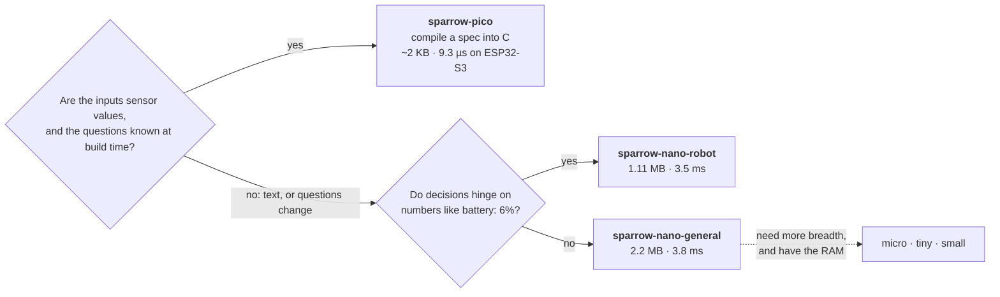
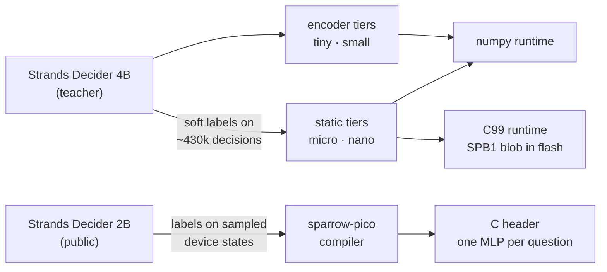

<p align="center">
  
</p>

<p align="center">
  <a href="https://huggingface.co/sparrow-decider"></a>
  <a href="https://pypi.org/project/sparrow-decider/"></a>
  <a href="https://github.com/sparrow-decider/sparrow-decider/blob/main/LICENSE"></a>
  
  
  
  
</p>

<p align="center">
  <a href="#quickstart">Quickstart</a> ·
  <a href="#the-family">Models</a> ·
  <a href="#benchmarks">Benchmarks</a> ·
  <a href="https://github.com/sparrow-decider/sparrow-decider/tree/main/docs/quickstart">Guides</a> ·
  <a href="https://github.com/sparrow-decider/sparrow-decider/blob/main/research/REPORT.md">Research report</a>
</p>

---

<h3 align="center">Decisions that fit on a chip.</h3>

**Sparrow Decider** is a family of decision models small enough to live inside your agent, your robot
or your microcontroller. They answer three kinds of question about a state:

- **yes / no** (`noul`)
- **pick one** (`choice`)
- **rate on a scale** (`score`)

They return calibrated probabilities in the same shapes as
[Strands Decider](https://github.com/strands-labs/strands-decider). They do it in about a
millisecond on one CPU core, or microseconds on a chip, with no GPU, no network and no model server.

```text
state     battery: 6%   front_obstacle_m: 7.0   path: clear
question  What should the robot do next?   continue | slow | stop | dock | replan
answer    dock                        9.3 µs on a $10 ESP32-S3 (sparrow-pico)
```

> Unofficial community project. Not an AWS or Strands product.

## Quickstart

```bash
pip install sparrow-decider          # numpy only, 3.3 MB installed, two models bundled
```

```python
from sparrow_decider import Decider

d = Decider.load()                                  # sparrow-nano-general-v1.1
d.ask("User: I was charged twice for order 1182, I want my money back", {
    "tool":    {"type": "choice", "instructions": "Which tool fits this request?",
                "criteria": {"flights": "search and book flights", "refunds": "refund a payment",
                             "weather": "forecasts for a city", "calendar": "create or move meetings"}},
    "upset":   {"type": "noul",   "instructions": "Is the user upset?"},
    "urgency": {"type": "score",  "instructions": "How urgent is this?", "criteria": ["can wait", "today", "now"]},
})                                                  # tool -> refunds (p = 0.98)
```

```bash
sparrow-decider ask "operator: grab that blue bottle" --choice "Which skill?" \
    -o "pick=pick up an object" -o "navigate=move somewhere" -o "speak=answer the person"
sparrow-decider serve --port 8000                   # POST /v1/systemone
```

| Guide | |
|---|---|
| [Python](https://github.com/sparrow-decider/sparrow-decider/blob/main/docs/quickstart/python.md) | API, models, CLI, HTTP server |
| [Agents](https://github.com/sparrow-decider/sparrow-decider/blob/main/docs/quickstart/agents.md) | routing and gating inside an agent, including as a Strands tool |
| [ESP32-S3](https://github.com/sparrow-decider/sparrow-decider/blob/main/docs/quickstart/esp32.md) | text decisions on a microcontroller in 3.5-7.6 ms, plus QEMU if you have no board |
| [sparrow-pico](https://github.com/sparrow-decider/sparrow-decider/blob/main/docs/quickstart/pico.md) | compile a decision for your device into a few KB of C |
| [C library](https://github.com/sparrow-decider/sparrow-decider/blob/main/docs/quickstart/c.md) | the runtime anywhere a C99 compiler runs |

## The family

| Tier | Model | Size | Input | Runs on | Time / question |
|:--|:--|--:|:--|:--|--:|
| **pico** | compiled per device, e.g. `sparrow-pico-rover-v1.1` | **~2 KB** / question | numbers, flags, enums | any MCU | 0.18 µs · **9.3 µs on ESP32-S3** |
| **nano** | `sparrow-nano-general-v1.1` | 2.2 MB | text | ESP32-S3, Pi, laptop | 0.06 ms · **3.8 ms on ESP32-S3** |
| **nano** | `sparrow-nano-robot-v1.2` | 1.11 MB | text with sensor readings | ESP32-S3, Pi, laptop | 0.08 ms · **3.5 ms on ESP32-S3** |
| **micro** | `sparrow-micro-general-v1.1` | 7.6 MB | text | Pi, laptop, 16 MB ESP32-S3 | 0.22 ms |
| **tiny** | `sparrow-tiny-general-v1.0` | 17.9 MB | text | Pi, laptop | 23 ms |
| **small** | `sparrow-small-general-v1.0` | 47 MB | text | Pi, laptop, Jetson | 64 ms |

<sub>Times are p50 on one Apple M4 Pro core: the C runtime for pico, nano and micro, numpy for tiny and
small. The nanos are bundled with the Python package; the others are on <a href="https://huggingface.co/sparrow-decider">Hugging Face</a> and the <a href="https://github.com/sparrow-decider/sparrow-decider/releases">releases page</a>. IDs follow <a href="https://github.com/sparrow-decider/sparrow-decider/blob/main/NAMING.md">NAMING.md</a>.</sub>

### pico or nano?



**nano** reads text and answers any question you pose at runtime. **pico** has no text and no
vocabulary: you describe your device's sensors and questions in a spec, a full Strands Decider labels
thousands of sampled states, and the compiler writes one tiny MLP per question as a C header. Many
devices use both: pico in the control loop, nano for anything said or written.

## Benchmarks

<table>
<tr><th>Model</th><th align="right">Size</th><th align="right">RobotBench<br/><sub>55 robot decisions</sub></th><th align="right">MASSIVE<br/><sub>domain / intent</sub></th><th align="right">JevBench<br/><sub>231 public tasks</sub></th></tr>
<tr><td>Strands Decider 4B v22 <sub>(teacher)</sub></td><td align="right">4B params</td><td align="right">46</td><td align="right">not run</td><td align="right">188</td></tr>
<tr><td>Strands Decider 2B v1 <sub>(public)</sub></td><td align="right">2B params</td><td align="right">40</td><td align="right">0.86 / 0.87</td><td align="right">180</td></tr>
<tr><td><b>sparrow-nano-robot-v1.2</b></td><td align="right">1.11 MB</td><td align="right">36</td><td align="right">0.52 / 0.52</td><td align="right">115</td></tr>
<tr><td><b>sparrow-nano-general-v1.1</b></td><td align="right">2.2 MB</td><td align="right">32</td><td align="right">0.50 / 0.59</td><td align="right"><b>122</b></td></tr>
<tr><td>sparrow-micro-general-v1.1</td><td align="right">7.6 MB</td><td align="right">30</td><td align="right">0.64 / 0.54</td><td align="right">117</td></tr>
<tr><td>sparrow-tiny-general-v1.0</td><td align="right">17.9 MB</td><td align="right">20</td><td align="right">0.37 / 0.59</td><td align="right">123</td></tr>
<tr><td>sparrow-small-general-v1.0</td><td align="right">47 MB</td><td align="right">24</td><td align="right">0.67 / 0.60</td><td align="right">122</td></tr>
</table>

<sub>
<b>RobotBench v0:</b> written by hand, separately from the robot training generator.
<b>MASSIVE:</b> Amazon MASSIVE 1.1 en-US test, 600 utterances, never trained on.
<b>JevBench:</b> local v1.5 proxy, not leaderboard scores; the 4B and 2B JevBench numbers are earlier local runs.
Full tables, ablations and C parity are in <a href="https://github.com/sparrow-decider/sparrow-decider/blob/main/bench/RESULTS.md">bench/RESULTS.md</a>.
</sub>

**sparrow-pico**, compiled from the public 2B for the [rover spec](https://github.com/sparrow-decider/sparrow-decider/blob/main/c/examples/specs/rover.json) and
tested on 600 held-out states:

| Question | pico vs teacher | Teacher vs the spec's rules | pico vs the spec's rules |
|---|--:|--:|--:|
| next action (5 options) | 97.7% | 94.2% | **94.0%** |
| needs charging (yes/no) | 99.8% | 99.0% | **99.2%** |

### On a real ESP32-S3

Measured on an ESP32-S3 (240 MHz, 16 MB flash, 8 MB PSRAM) with `bench/esp32/run.py`. There are 155
decisions (RobotBench and 100 MASSIVE intent cases), and every on-chip answer was compared with the
host runtime.

| Model | p50 per decision | First on-chip build | Matches host |
|---|--:|--:|--:|
| sparrow-pico-rover-v1.1 | **9.3 µs** | 42.9 µs | 256/256 |
| sparrow-nano-general-v1.1 | **3.8 ms** | 9.6 ms | 152/155 |
| sparrow-nano-robot-v1.2 | **3.5 ms** | 73.5 ms | 150/155 |

These speedups come from the configuration, not new hardware:
- options scored in batches
- int8 dot products on the S3 vector unit (ESP-NN kernel)
- a 64 KB data cache
- the model blob in PSRAM, with the MLP weights in internal RAM

The few mismatches against the host are int8 rounding near ties.

### What this means

- **Good at:** fast, local decisions in a known domain. On navigation from sensor readings, the 1.11 MB
  nano-robot gets 8/10 calls right where the public 2B gets 3/10.
- **Weak at:** open-ended language it never trained on. On MASSIVE, every Sparrow model is well
  behind the 2B.
- **Weak at:** yes/no judgement. On JevBench's yes/no tasks, every tier is near chance. Use a full
  decider or an LLM for those.

## How it works



- **Static tiers (micro, nano):**
  - Each segment (state, question, option) is mean-pooled from an int8 embedding table.
  - An MLP scores every option against the state and the question.
  - nano prunes the vocabulary to 8k-16k pieces and projects the vectors to 128-d.
  - `nano-robot` adds **key-value number pooling**: `battery: 6%` becomes the battery's vector times a
    learned function of 6. Across seeds this is worth 6-8 RobotBench points.
- **Encoder tiers (tiny, small):** Ettin encoders with a pointer head over the options.
- **pico:** distillation into a per-question MLP over the raw feature vector.

Methods, ablations and limits are in the [research report](https://github.com/sparrow-decider/sparrow-decider/blob/main/research/REPORT.md).

## Repository

```text
python/sparrow_decider   numpy runtime, CLI, bundled nano models
c/sparrow                C99 runtime (ESP-IDF component)     c/tools   packer, ESP-IDF wrapper
c/examples               ESP32-S3 example, pico specs        c/tests   C-vs-Python parity
training/                every training, distillation, calibration and compile script
bench/                   RobotBench, MASSIVE, JevBench runners, results, RESULTS.md
research/REPORT.md       methods, ablations, findings
docs/                    quickstarts, model card
site/www                 the website (static, generated from site/facts.json by site/www/_build/build.py)
site/brand               logo, colours (tokens.css), brand guide      site/marketing   launch post, press kit
```

## Credits

- **Code:** Apache-2.0.
- **Base weights:** micro and nano are initialised from
  [potion-base-8M](https://huggingface.co/minishlab/potion-base-8M) (MinishLab, MIT). tiny and small
  are initialised from the [Ettin encoders](https://huggingface.co/jhu-clsp) (Johns Hopkins CLSP, MIT).
- **Teachers and prompt format:** [Strands Decider](https://github.com/strands-labs/strands-decider)
  (Apache-2.0).
- **Evaluation only:** JevBench (MIT) and Amazon MASSIVE (CC BY 4.0).

See [NOTICE](https://github.com/sparrow-decider/sparrow-decider/blob/main/NOTICE) and [docs/models.md](https://github.com/sparrow-decider/sparrow-decider/blob/main/docs/models.md). To cite, use [CITATION.cff](https://github.com/sparrow-decider/sparrow-decider/blob/main/CITATION.cff).

## Contact

- **Email:** [vivek@sparrowdecider.com](mailto:vivek@sparrowdecider.com)
- **Questions and results:** [GitHub Discussions](https://github.com/sparrow-decider/sparrow-decider/discussions)
- **Bugs:** [GitHub Issues](https://github.com/sparrow-decider/sparrow-decider/issues)
